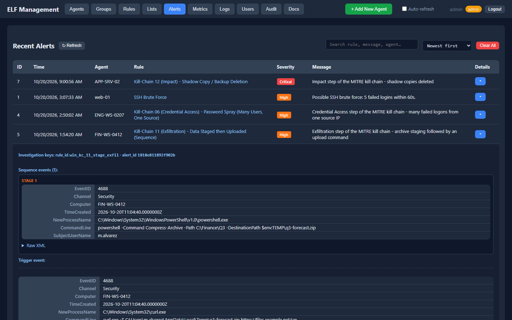
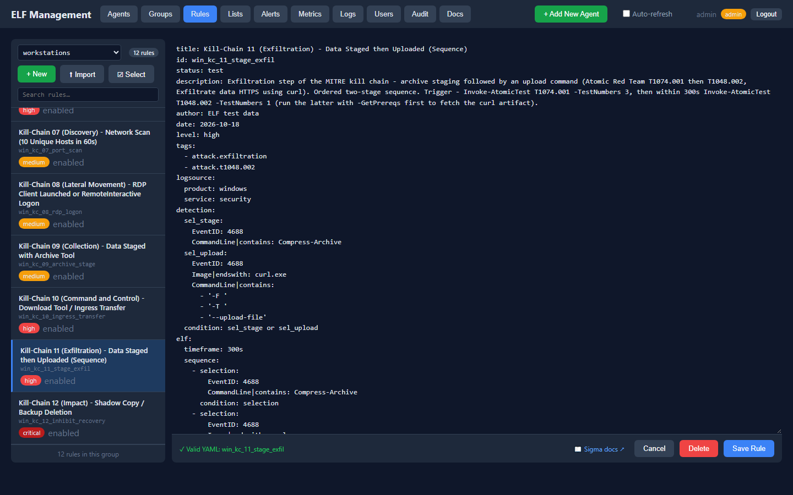
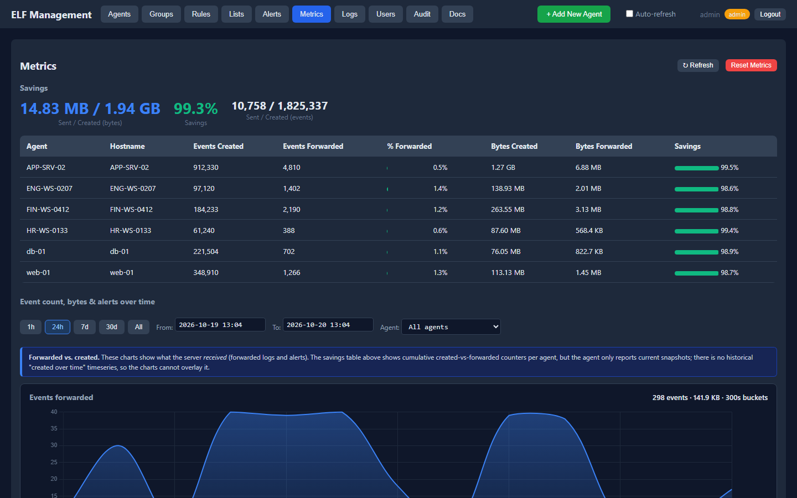
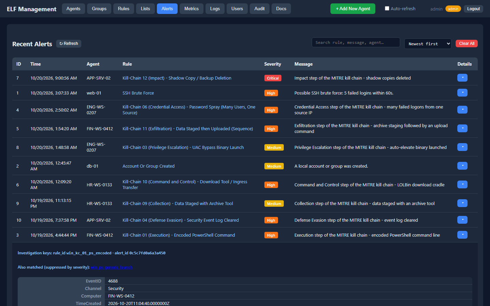
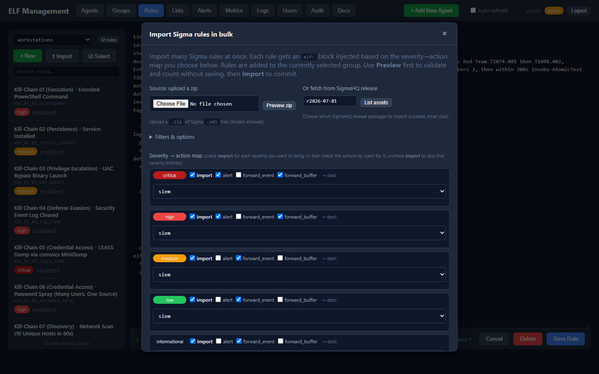
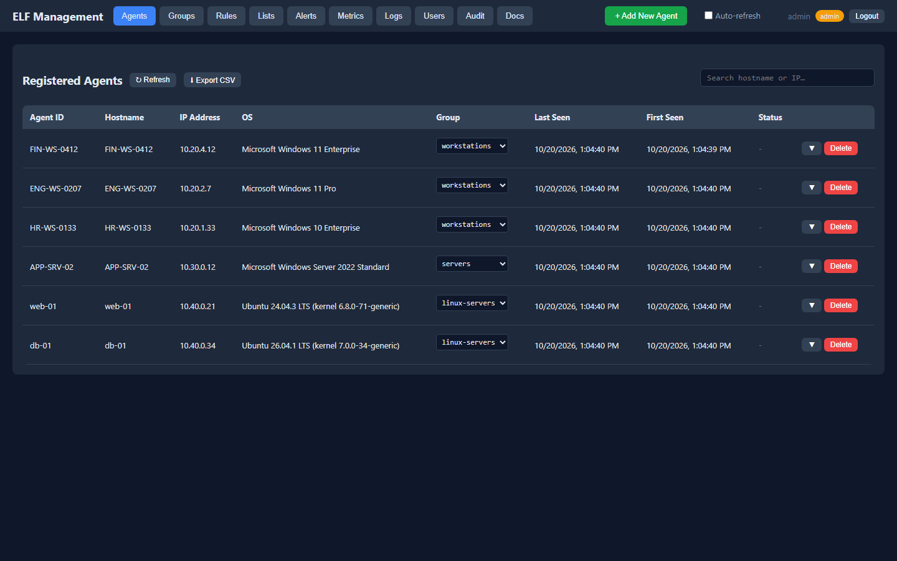
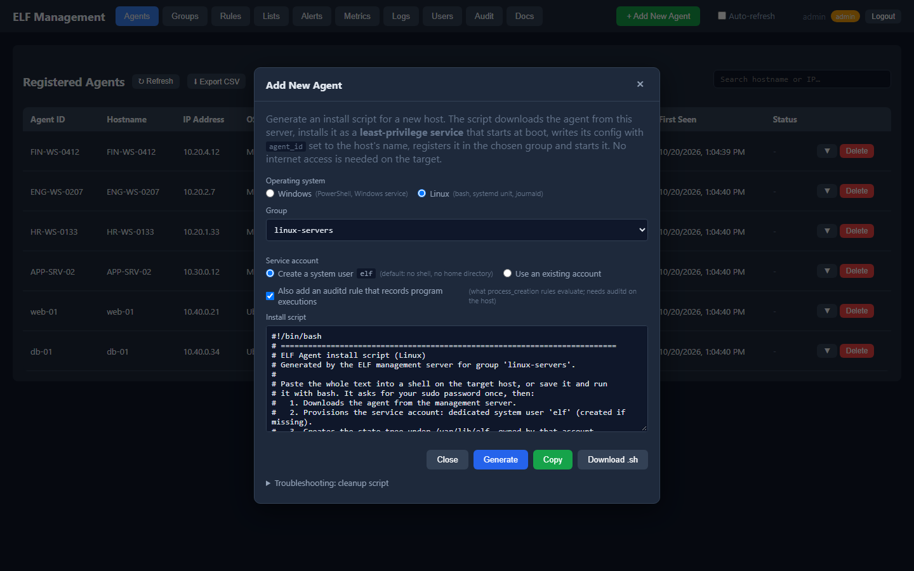

# ELF (Efficient Log Forwarder)

[](https://github.com/colewesterlund/elf/actions/workflows/ci.yml)
[](https://github.com/colewesterlund/elf/releases)
[](LICENSE)

ELF is a log forwarder with a detection engine inside it. An agent on each
host reads the local log (the Windows Event Log, or the systemd journal and
the kernel audit stream on Linux), runs [Sigma](https://github.com/SigmaHQ/sigma)
detection rules on the events locally, and sends the alerts plus the events
around them to a SIEM (Splunk, Graylog or Microsoft Sentinel) or to a file.
A web console manages the agents, the rules and the destinations.

The agent is one C++17 executable that runs as a Windows service or a
systemd unit under a limited account. The console is a Python/FastAPI
application that runs in Docker. The name has nothing to do with the ELF
binary format.

<p align="center"></p>

## The problem it addresses

SIEM licenses are usually priced by the amount of data ingested, so many
teams forward only part of their Windows event logs and lose visibility on
the rest. The cost pressure reaches back into audit policy: process creation,
command lines, object access and filtering-platform events are often left
switched off because nobody wants to pay to ship them.

ELF runs the rules on the host instead, so the volume a host logs is no
longer tied to what the SIEM is paid for. Administrators can turn auditing up
as far as they find useful. The agent evaluates every event where it is
written, and the SIEM receives the alert, the rule that produced it and the
events around it, not the whole stream.

The events around an alert come from the agent's buffer. Every collected
event is held in memory for a retention period set per group, from a few
seconds up to a few days. When a rule fires, the alert goes out with all the
context that retention defines: the events leading up to what triggered it,
without anyone having forwarded them in advance.

Volume reduction does not mean dropping what you must keep. A rule whose
action is `forward_event` sends every matching event as it happens, so the
same agent can forward all logons and account changes for compliance while
other rules decide what deserves an alert.

## Features

Detection on the host

- Rules are standard Sigma YAML with a short `elf:` section at the end that
  says what to do on a match: raise an alert, forward the matching event, or
  forward the buffer as context.
- Rules can count events over a time window (five failed logons from one
  address within a minute) or require events in order (an archive is created,
  then uploaded).
- When several rules match the same event, the most severe one alerts and
  the others are listed on that alert.
- Bulk import from a zip file or from the SigmaHQ release packages, with a
  choice of which severities should alert.

Collection

- The agent subscribes only to the event types its rules can match, so the
  host delivers a fraction of the log: Windows by event id per channel,
  Linux by journal identifier (sshd, sudo, cron, the audit stream).
- It keeps its position in each log across restarts; events are neither lost
  nor read twice.
- On Linux the records of one audit event are joined, so a process start
  carries the executable, the command line, the user and the audit key in
  one event, the shape Sigma's Linux rules expect.

Delivery

- A destination is a URL. The `format` option picks the document shape:
  `hec` for Splunk, `gelf` for Graylog, `sentinel` for Microsoft Sentinel,
  `ecs` or `json` for other JSON consumers, `raw` for the original event
  XML.
- Each alert and each forwarded event carries the rule id and an alert id,
  so an analyst can search for one incident or for everything a rule has
  produced.
- Outgoing data is queued on disk and retried. An unreachable SIEM does not
  stall the agent, and an event goes to a destination once even when several
  rules request it.

Management console

- Agents belong to groups; each group has its own rules, destinations and
  settings, picked up on the next poll.
- Rule editor with validation, alerts with their triggering event and
  context, forwarded-log and metrics pages, user roles, an audit log.
- Generates the script that installs the service on a new host: PowerShell
  for Windows, bash with a systemd unit for Linux.

## Architecture

```
  Windows or Linux host                                SIEM
  +-------------------------------------------+        +---------------------+
  |  ELF agent (service / systemd unit)       |        |  Splunk             |
  |                                           |  alerts and context events  |
  |  Event Log --> rule engine --> forwarder -------->  |  Graylog            |
  |  or journal       |                       |        |  Microsoft Sentinel |
  |                   |                       |        |  or a file          |
  +-------------------|-----------------------+        +---------------------+
                      |
          rules and settings down,
          alerts and logs up
                      |
  +-------------------v-----------------------+
  |  ELF console (Docker: FastAPI + SQLite)   |
  |  agents, groups, rules, alerts, metrics   |
  +-------------------------------------------+
```

Agents poll the console for their group's rules and settings and report
alerts back; the console never connects to an agent. Forwarding to the SIEM
goes directly from the host.

## Setup

Start the console with Docker, then open `http://localhost:8000` and log in
as `admin`:

```bash
cd server && ELF_ADMIN_PASSWORD='choose-a-strong-one' docker compose up -d --build
```

(A prebuilt image, `ghcr.io/colewesterlund/elf-server`, is published with
each release; see [server/README.md](server/README.md).)

To add a host, click **Add New Agent** in the console, pick the operating
system and the group it should join, and copy the generated script.

On Windows, run it from an elevated PowerShell. The script downloads the
agent from the console, creates a local service account with only the
rights the agent needs (log on as a service, read the event logs), writes
the configuration, and installs and starts the service. If you prefer an
existing domain account, choose that option in the dialog; the script then
prompts for its password on the host and uses it instead of creating one.

On Linux, paste it into a shell on the host, or run the downloaded file
with `bash`; it asks for your sudo password. The script downloads the
agent, creates an `elf` system user (or uses an account you name) with
read access to the journal, writes the configuration under `/etc/elf`, and
installs and starts a systemd unit. Tick the audit option if the group's rules watch process
starts; it installs the `execve` audit rule those rules need.

Either way the host appears on the Agents page within a minute.

[docs/DEMO.md](docs/DEMO.md) walks from an empty console to the first
alert and shows where to look for it.

## Sending alerts to a SIEM

Add a destination to a group (or to the agent's `config.ini`) and point a
rule's action at it:

```
splunk   = https://splunk.example.com:8088/services/collector/event?format=hec&token=<HEC token>&index=elf
graylog  = http://graylog.example.com:12201/gelf?format=gelf
sentinel = https://<dce>.ingest.monitor.azure.com/dataCollectionRules/<dcr-id>/streams/Custom-ELF_CL?api-version=2023-01-01&format=sentinel&tenant=<tenant>&client=<app-id>&secret=env:ELF_SENTINEL_SECRET
```

[docs/SIEM.md](docs/SIEM.md) covers the setup for each one and gives example
searches.

## Rule editor and features

Rules are edited in the console, one ruleset per group. The editor checks
the Sigma syntax, the field modifiers and the `elf:` section before saving,
and agents pick the change up on their next poll. Rules can also be
imported in bulk from a zip file or straight from the SigmaHQ release
packages, with a choice of which severities should alert.

A rule is ordinary Sigma YAML with a short `elf:` section that says what
happens on a match. A Windows rule that counts failed logons:

```yaml
title: Brute Force Logon Attempt
id: win_brute_force_logon
level: high
logsource: {product: windows, service: security}
detection:
  selection: {EventID: 4625}
  condition: selection
elf:
  threshold: 5
  timeframe: 60s
  group_by: TargetUserName
  actions:
    - {type: alert, destination: alerts, message: "5 failed logons within 60s."}
    - {type: forward_buffer, destination: siem}
```

A Linux rule that watches for a local account being created:

```yaml
title: Account Or Group Created
id: lin_new_user_or_group
level: medium
logsource: {product: linux, service: useradd}
detection:
  selection:
    Message|startswith: ['new user', 'new group']
  condition: selection
elf:
  actions:
    - {type: alert, destination: alerts, message: "A local account or group was created."}
    - {type: forward_buffer, destination: siem}
```

What the analyst gets is the same on both platforms. The alert arrives in
the SIEM with the rule, the event that triggered it, and for the Windows
rule the five logons that filled the window. The configured buffer is
forwarded with it: everything the host logged in the retention window before
the trigger, each event stamped with the rule id and the alert id, so one
search returns the incident and the activity that led to it. Nothing else
from that host was sent. Rules that must forward continuously (every logon,
every account change, for compliance) use `forward_event` and run alongside.

## Screenshots

| Rule editor | Metrics |
|---|---|
|  |  |
| Alert detail | Bulk import from SigmaHQ |
|  |  |
| Agents (Windows and Linux) | Add New Agent (Linux) |
|  |  |

## Documentation

- [docs/USAGE.md](docs/USAGE.md): configuration, the rule format, actions, the console, troubleshooting
- [docs/SIEM.md](docs/SIEM.md): Splunk, Graylog, Microsoft Sentinel, ECS/JSON
- [docs/DEMO.md](docs/DEMO.md): the walkthrough in detail
- [docs/DEPLOYMENT.md](docs/DEPLOYMENT.md): the agent's security model, fleet installs, upgrades
- [docs/DEVELOPER.md](docs/DEVELOPER.md): how the code is organized and how to extend it
- [server/README.md](server/README.md): API reference
- [CHANGELOG.md](CHANGELOG.md), [SECURITY.md](SECURITY.md), [CONTRIBUTING.md](CONTRIBUTING.md)

## Building from source

Windows with Visual Studio 2022 Build Tools and CMake 3.20 or newer:

```powershell
cmake -S . -B build "-DCMAKE_POLICY_VERSION_MINIMUM=3.5" -DCMAKE_BUILD_TYPE=Release
cmake --build build --config Release
build\Release\test_rule_engine.exe
```

The executable is statically linked and needs no runtime installed on the
target host.

Linux (Debian or Ubuntu package names; the agent needs `libsystemd` and
`libcurl` at runtime):

```bash
sudo apt-get install -y cmake g++ pkg-config libsystemd-dev libcurl4-openssl-dev
cmake -S . -B build -DCMAKE_POLICY_VERSION_MINIMUM=3.5 -DCMAKE_BUILD_TYPE=Release
cmake --build build -j"$(nproc)"
(cd build && ./test_rule_engine)
```

The agent test suite on both platforms, the console tests and a browser
test of the web interface run in CI on every push.

## Limitations

- ELF is only as good as its rules and settings. What never matches a rule
  never leaves the host, so a thin ruleset means thin coverage, and a short
  retention window means thin context.
- It filters what reaches the SIEM; it does not replace one. Keep the SIEM
  in the pipeline for correlation across hosts, retention and search.
- Community rules need tuning. The SigmaHQ rules match broadly by design, so
  expect false positives after a bulk import and adjust the rules, their
  severities or their actions for your environment before relying on the
  alerts.
- The agent and the console talk plain HTTP. Put a reverse proxy with TLS in
  front of the console for anything beyond a lab.
- The Linux agent reads the systemd journal, so it needs systemd, and it
  only sees process starts when auditd records them (the install script
  can set that up). Hosts without systemd are not supported.
- The console runs anywhere Docker does.
- The console uses SQLite and is meant for a single server.
- Release binaries are not code-signed. Compare them against
  `SHA256SUMS.txt`.

## Acknowledgements

The rule format and the community rules come from [SigmaHQ](https://github.com/SigmaHQ/sigma).
The tests behind the sample attack chain come from [Atomic Red Team](https://github.com/redcanaryco/atomic-red-team).
Built with [yaml-cpp](https://github.com/jbeder/yaml-cpp), [nlohmann/json](https://github.com/nlohmann/json),
[FastAPI](https://fastapi.tiangolo.com/) and [Chart.js](https://www.chartjs.org/).
See [THIRD_PARTY_NOTICES.md](THIRD_PARTY_NOTICES.md).

MIT licensed. Written by Cole Westerlund.
